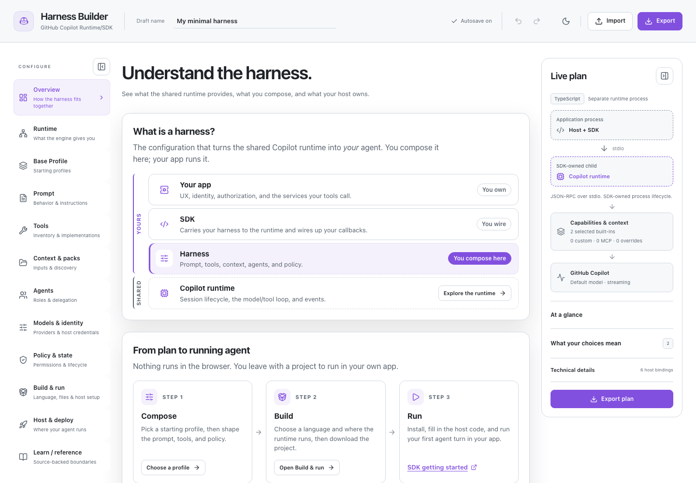

<!-- Copyright (c) Microsoft Corporation. All rights reserved. -->

# Copilot Harness Builder

A local-first web app for designing a harness on the GitHub Copilot runtime. It helps you explore configuration choices, understand runtime and host responsibilities, and export implementation plans or SDK bootstrap projects.

The builder does not start agents, call model services, execute tools, or store credentials.

**[Try the live Copilot Harness Builder](https://patniko.github.io/copilot-sdk-visualizer/)**

[](https://patniko.github.io/copilot-sdk-visualizer/)

## What you can do

- Configure prompts, tools, MCP servers, context, agents, models, policies, sessions, and evaluation criteria.
- Cover newer SDK session options: discovery-only agent/hook/instruction roots, custom-instruction loading, SDK lifecycle hooks and host request handlers, host-injected managed policy, model allowlists and routing preferences, custom-provider overrides, tool search and deferral, session naming, diagnostics, resume behavior, and per-run structured output.
- See SDK options the SDK marks as experimental (such as the skill provider and image generation) flagged with an **Experimental** badge.
- Explore runtime capabilities and trace an illustrative model/tool turn.
- Compare local, container, managed-cloud, and production hosting architectures.
- Choose managed-process, existing-service, or experimental in-process runtime placement.
- Export planner JSON, a TypeScript integration sketch, a Copilot CLI task, or a language-specific bootstrap ZIP.
- Inspect source-backed SDK mappings, built-in tools, prompt references, requirements, and limitations.

Selections describe a plan, not granted authority or guaranteed availability. The host still owns identity, tenant authorization, secrets, deployment isolation, effectful services, and evaluation.

## Run locally

Requires Node.js 22.12 or newer and pnpm 11.19.

```bash
pnpm install
pnpm dev
```

Vite listens on `127.0.0.1`. Start on **Overview**, configure the harness, then use **Build & run** to select a language and runtime placement.

## Development

```bash
pnpm format
pnpm lint
pnpm test
pnpm build
```

Run browser and contract checks separately:

```bash
pnpm test:browser
pnpm test:contract
```

`COPILOT_SDK_SOURCE` can point contract tests at a local SDK checkout:

```bash
COPILOT_SDK_SOURCE=/path/to/copilot-sdk/nodejs/src/index.ts pnpm test:contract
```

The SDK checkout is not required to build or use the app.

## Publish to GitHub Pages

```bash
pnpm deploy:pages
```

The command requires a clean, pushed source branch and publishes `dist/` to `gh-pages`. Validate without publishing with:

```bash
pnpm deploy:pages -- --dry-run
```

Configure GitHub Pages to deploy from the `gh-pages` branch at `/ (root)`.

## Project boundaries

- Presets configure one shared runtime; they are not separate engines or capability tiers.
- Planner JSON is not serialized SDK `SessionConfig`.
- Exports cannot serialize host callbacks or provide authorization.
- Generated projects contain explicit host integration points and may intentionally fail preflight until required callbacks are implemented.
- Model, tool, and capability catalogs are pinned reference snapshots, not live entitlement checks.
- Browser storage holds the local draft and is not a secret vault.

For implementation details, use the in-app **Learn / reference** area and the [GitHub Copilot SDK documentation](https://github.com/github/copilot-sdk/tree/main/docs).
